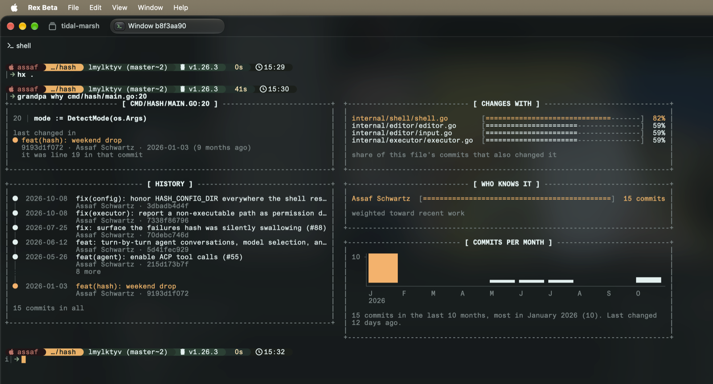
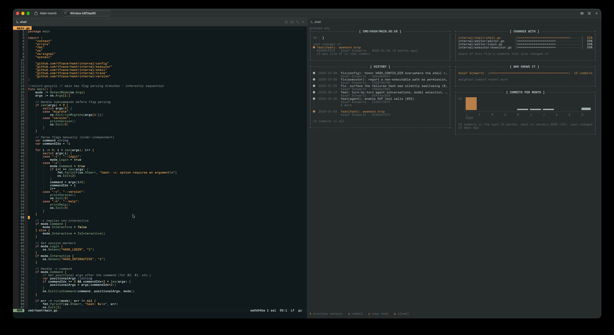

# marlex

marlex remembers your repository's history, like your grandfather. so don't ask git.

A git history index. `mx` answers log, blame and ownership questions in milliseconds, and works in a depth-1 clone.

On kubernetes (163,022 commits):

| | git | mx |
|---|---|---|
| commits that touched a file | 43 ms | 4.6 ms |
| the same, following renames | 637 ms | 4.5 ms |
| blame a whole file | 39 ms | 6.0 ms |
| history on a CI worker | 1.4 GB full clone | 51 MB depth-1 clone + 14 MB index |

What you get:

- **History queries:** `log`, `blame`, `show`, `cochange`, `owners`, `hotspots` and `why`, each with `--json`.
- **History in shallow clones:** `build` and `publish` where the full history is, `pull` and `ff` in CI.
- **Test ordering:** `order` lists the test units your change is most likely to break.

## Install

```sh
go install github.com/tfcace/marlex/cmd/mx@latest
```

> [!NOTE]
> Needs Go 1.22+ and git. Tested on macOS; Linux should work but is untested. Windows and SHA-256 repositories are not supported.

## Quick start

```sh
cd your-repo
mx                               # what marlex knows here, and questions to try
mx log --follow src/server.go    # the commits that touched it, across renames
mx blame -L 40,60 src/server.go  # who last changed each line
mx show a1b2c3d                  # a commit's message, author and files
mx cochange src/server.go        # the files that usually change with it
mx owners src/                   # who has worked here, recent work counting most
mx hotspots src/ --since 26w     # the files that change most
mx why src/server.go:42          # one card: last commit, history, companions, who knows it
mx order -n 5                    # the test units your change is most likely to break
```

There is no setup step. The first question in a repository indexes it and says what it found:

```
mx: indexed 1,110 commits in 200ms: 13 years of history by 353 people
```

New commits are indexed on the next question.

Paths work as in git. Typos get a suggestion:

```
$ mx log cmd/mx/mian.go
mx: cmd/mx/mian.go has no history in the index (did you mean cmd/mx/main.go?)
$ mx log --folow cmd/mx/main.go
mx log has no --folow flag (did you mean --follow?)
```

> [!TIP]
> `mx help` lists every command. `mx help why` shows one with its flags and examples.

## Shallow clones and CI

A depth-1 checkout has no history to ask about. Build and publish the index where the full history is, then pull it where it isn't:

```sh
# where the full history is: a post-merge job, for example
mx build --hunks
mx publish /mnt/bucket/myrepo       # a directory you sync to S3, R2 or GCS

# in the shallow clone
mx pull https://example.com/myrepo          # or a directory
mx pull --hunks https://example.com/myrepo  # with the line ranges, if you want blame
mx log --follow src/server.go
```

- **Small:** 14 MB for kubernetes, against a 1.4 GB full clone.
- **Incremental:** files are immutable and content-addressed, so a warm machine downloads only new pieces.
- **Verified:** each file is checked against the SHA-256 in its name. A corrupt or tampered download is refused.
- **Any static host:** a directory, S3, R2 or GCS. No server to run.

> [!IMPORTANT]
> The index flows one way, from the full clone to the shallow ones. In a pulled clone, `publish` refuses.

A pull-request job checks out a branch the published index doesn't have. `mx ff` brings the index forward: it deepens the clone just until the commits where its history is cut off are in the index, then indexes the branch's commits on top. After it, every query covers the branch, and `order` measures the change from the newest main commit the branch contains, as a pull request's diff does:

```sh
mx pull https://example.com/myrepo
mx ff
go test $(mx order --list) ./...   # the likely failures first, then everything
```

Commits made in the clone after that are indexed by the next query and never published.

> [!WARNING]
> Without `ff`, a pull-request job sees history only up to HEAD's parent, and `order` needs `--files`. Queries print a warning saying where the index stops.

## Tests likely to fail first

`mx order` ranks the repository's test units for your current change (against the merge base with `origin/main`, or `--base`, or `--files`) and says why:

```
$ mx order -n 3
1 changed file(s), 26 test units

#  SCORE  UNIT                                    WHY
1  1.81   github.com/tfcace/hash/internal/shell   co-changed with internal/shell/shell.go in 22 of 53 commits; changed directly
2  0.61   github.com/tfcace/hash/cmd/hash         co-changed with internal/shell/shell.go in 3 of 53 commits; depends on changed code (distance 1)
3  0.33   github.com/tfcace/hash/internal/editor  co-changed with internal/shell/shell.go in 9 of 53 commits
```

The signals are the files that changed together with your change in the past, and import distance from it. It knows Go packages (through `go list`) and Jest, Vitest and pytest test files (through their imports).

`--list` prints one unit per line. go runs the named packages first and skips the duplicates, so `go test $(mx order --list) ./...` shows the likely failure first and still runs everything, at the cost of `go test ./...`. What that buys is measured under Performance.

## The why card, and Rex

`mx why FILE:LINE` draws a card in any terminal: the commit that last changed the line, the file's history, what changes with it and who knows it.



In [Rex](https://www.superlogical.com/rex), one key opens that card for whatever is on screen, so you never copy a path:

- **From any output:** the `file:line` nearest the cursor in a compiler error, test failure, stack trace or diff.
- **From your editor:** the line under the cursor, following it as you move.

Set it up with `mx rex install`. [docs/rex.md](docs/rex.md) has the editor settings and the rest.

[](docs/rex-blame.mov)

The recording is blame for a file open in Helix: the card opens beside the editor and follows the cursor.

## Scripting

- Every query takes `--json`. Piped, output is plain text. `NO_COLOR` turns color off and `MX_NO_MOTION=1` the animation.
- A path that doesn't exist never gets an empty answer. Unknown paths, directories where a file is required, and unresolvable revisions exit 1 with a message on stderr.
- When the index is behind and can't be refreshed (a shallow clone, or `--no-refresh`), the answer comes with a warning on stderr saying where the index stops.
- The index holds commits, paths and line ranges, not file contents. `show` lists what a commit changed; the text of an old version, or a patch, still comes from git, which a shallow clone may have to fetch.

> [!TIP]
> `MX_NO_REFRESH=1` or `--no-refresh` keeps queries from writing to `.git/marlex`, for read-only checkouts and sandboxes.

## How it works

The index lives in `.git/marlex`: a JSON manifest plus FlatBuffers files. Sizes are for kubernetes.

| File | Holds | Written | Size |
|---|---|---|---|
| core segment | commits, changed paths, per-path commit lists, interned strings | `build`; never modified after | 45.5 MB |
| delta segments | the same, for commits since the last build | each refresh; merged when there are over 10, or they reach half the base | small |
| reach | which refs reach which commit, as a bitmap | rebuilt on every update | 2.9 MB |
| hunks (optional) | line ranges of each change, for blame | `build --hunks`, or the first blame | 178 MB |
| blobs (optional) | the blob hash of each change | `build` | 32 MB |

- **No parsing:** a query memory-maps the files and binary-searches sorted columns in place. Opening the index takes 0.24 ms.
- **`log PATH`:** a hash lookup for the path's ID, a binary search for its commit list, then one contiguous read. Cost depends on the file's commits, not the repository's.
- **Force-push:** rewrites only the reach file. Segments are never touched.
- **Open format:** the schema is [`schema/index.fbs`](schema/index.fbs). Google's `flatc` decodes it without marlex, and [`bench/flatc_check.py`](bench/flatc_check.py) checks the decoded commits against git.
- **Git is the source of truth:** a format change old versions can't read is handled by `mx build` rebuilding the index.

## Performance

M-series Mac. git runs with its commit-graph and changed-path Bloom filters. [`bench/run.py`](bench/run.py) reproduces every number on any repository; raw results are in [`bench/results`](bench/results).

| | prometheus | kubernetes |
|---|---|---|
| commits | 21,485 | 163,022 |

**Build**, once, in a full clone:

| | prometheus | kubernetes |
|---|---|---|
| `mx build` | 1.1 s | 2.6 s |
| `mx build --hunks` (adds blame) | 4.3 s | 24 s |
| `git commit-graph write --reachable --changed-paths` | 0.1 s | 0.9 s |

**History on a worker:**

| | prometheus | kubernetes |
|---|---|---|
| git: full clone `.git` | 306 MB | 1.4 GB |
| mx: depth-1 clone `.git` | 6.7 MB | 51 MB |
| + core index, download (on disk) | 1.7 MB (6.5 MB) | 14 MB (46 MB) |
| + hunks for blame, download (on disk) | 3.8 MB (25 MB) | 23 MB (170 MB) |
| `mx pull`, both parts, local directory | 0.03 s | 0.15 s |

**Queries**, median of 50 files on kubernetes, one process per command:

| | git | mx |
|---|---|---|
| commits that touched a file | 43 ms | 4.6 ms |
| the same, following renames | 637 ms | 4.5 ms |
| blame a whole file | 39 ms | 6.0 ms |
| log, in-process (no startup) | | 0.2 µs median, 9 µs p90 |

**Correctness**, same 50 files:

| | prometheus | kubernetes |
|---|---|---|
| histories identical, full clone vs depth-1 + pulled index | 50 / 50 | 50 / 50 |
| blame identical to `git blame --first-parent` | 50 / 50 | 47 / 49 (see Known differences) |

**Test ordering**, one 26-package Go module, 10 cores:

| | |
|---|---|
| first failure, `go test ./...` | 0.8 s |
| first failure, `go test $(mx order --list) ./...` | 0.5 s |
| mutants whose failing package ranked first | 47 / 47 |

The gain grows with packages per core.

## Known differences from git

- History is recorded against each commit's first parent. A merge shows the changes it brought in, like `git log --first-parent` and `git blame --first-parent`.
- Renames are paired the way `git log -M` pairs them, one to one across the commit. `git blame` and `git log --follow` look harder for the source of a new file, so for a file created by copying another, marlex says "added here" where git traces the lines into the original. On kubernetes this affected 2 of 49 sampled files, both generated test fixtures.
- Automatic refresh follows HEAD. Other branches are brought up to date by the next refresh or `mx build`.

## About

This is version 0.1.0. I built it for my own repositories, and it should work for yours. The name is blending the names of my grandfathers, Marcel and Alex.

## License

MIT
